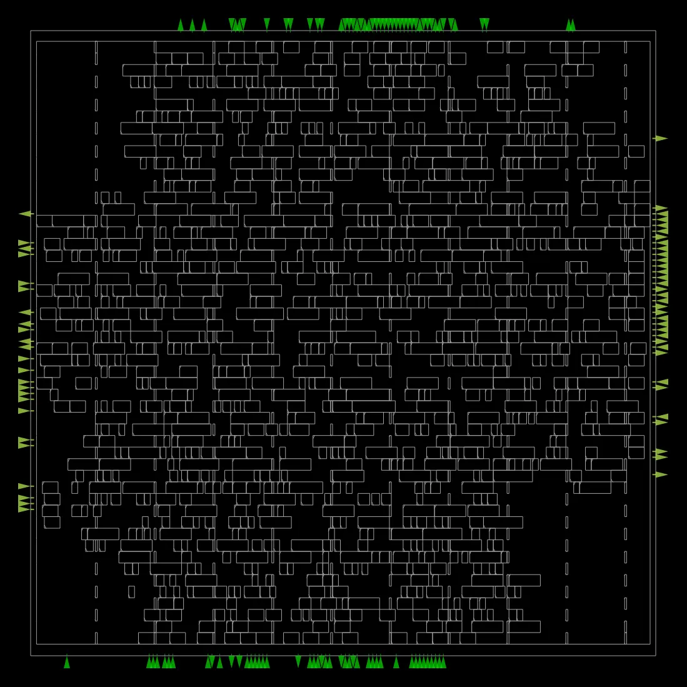
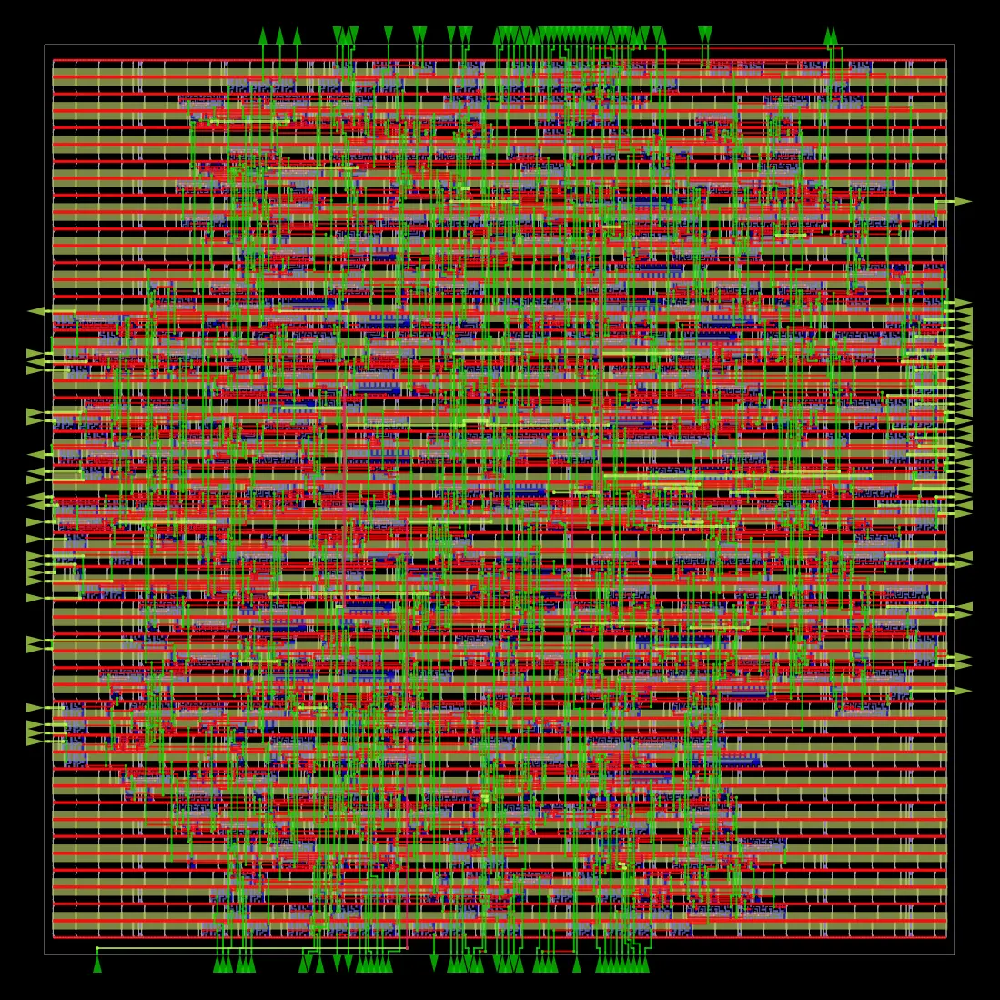
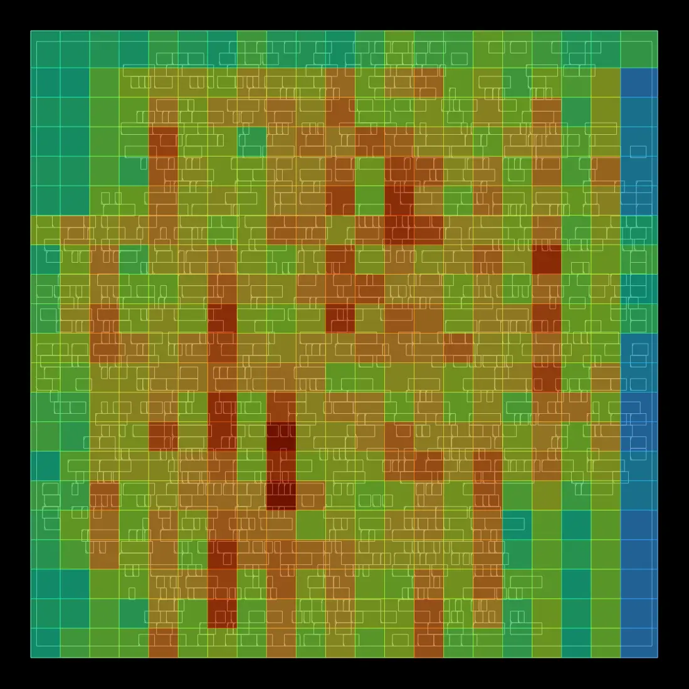
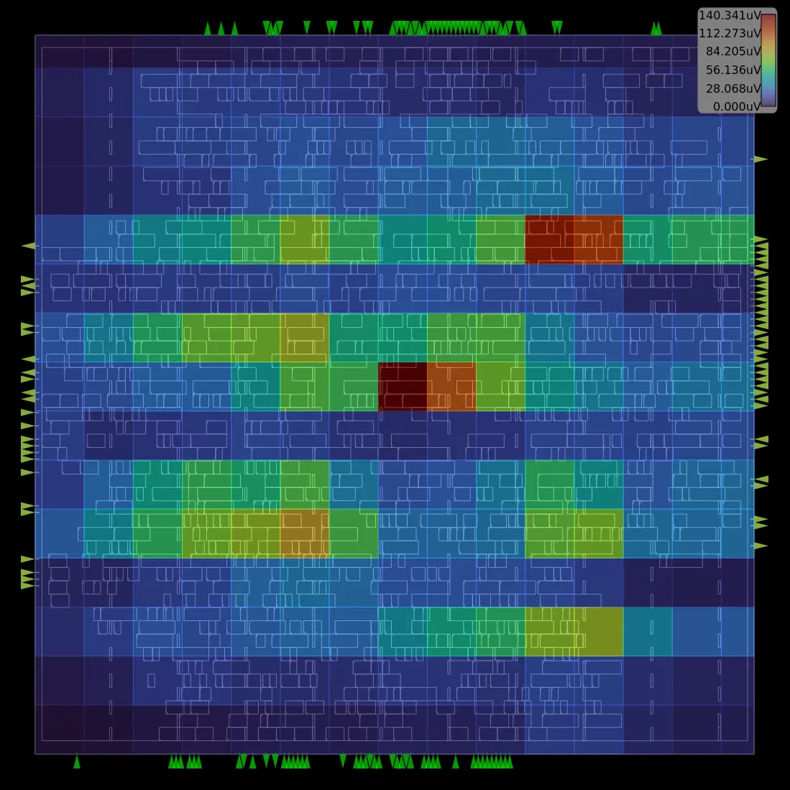
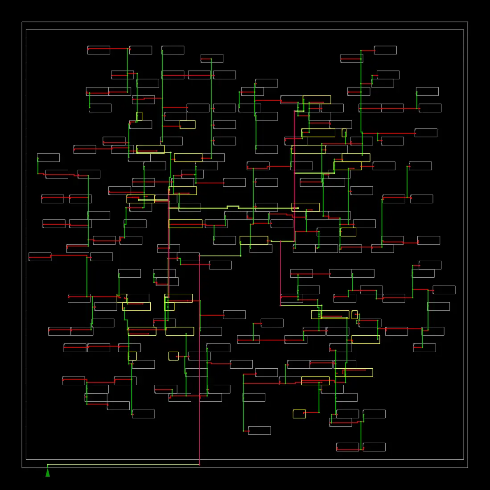
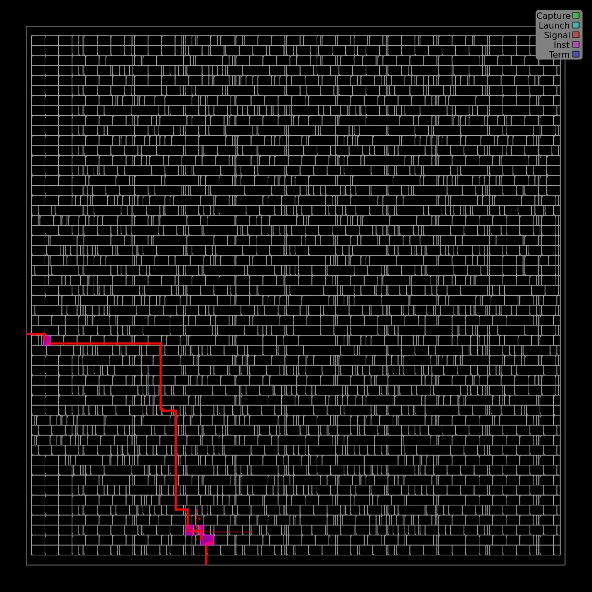
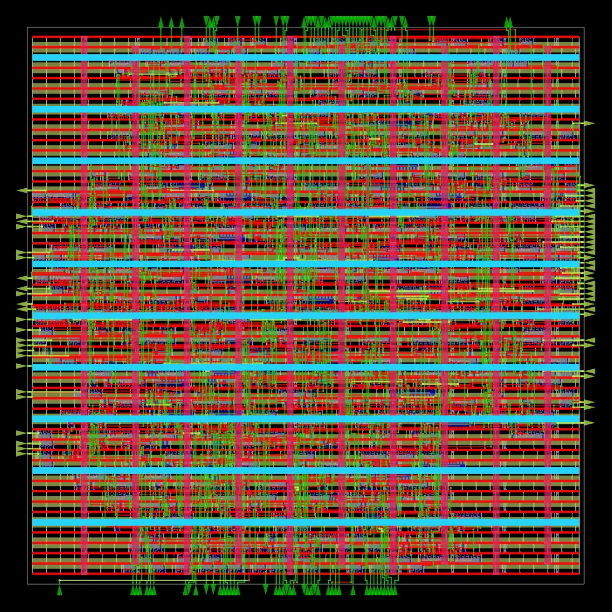

# AXI4-Lite Peripheral

A synthesizable memory-mapped AXI4-Lite peripheral with a self-checking SystemVerilog verification environment and a SKY130HD RTL-to-GDS implementation flow.

The project demonstrates RTL design, functional verification, synthesis, floorplanning, placement, clock-tree synthesis, routing, parasitic extraction, and physical-design reporting using open-source tools.

## Design overview

The peripheral exposes four 32-bit registers:

| Address | Register | Access | Reset/value |
|---|---|---|---|
| `0x00` | `CONTROL` | Read/write | `0x00000000` |
| `0x04` | `STATUS` | Read-only | `0x00000001` |
| `0x08` | `SCRATCH` | Read/write | `0x00000000` |
| `0x0C` | `VERSION` | Read-only | `0x00010000` |

The implementation supports byte write strobes on writable registers, independently arriving write-address and write-data channels, OKAY responses for valid accesses, and DECERR for unmapped addresses. Writes to read-only registers are ignored.

## Functional verification

The regression suite runs with Icarus Verilog and includes:

| Verification activity | Result |
|---|---|
| Functional scoreboard checks | 123 passed |
| Byte-enable coverage | All 16 WSTRB patterns exercised and checked |
| AXI protocol negative tests | 5 injected violations detected |
| Reset corner cases | 10 checks passed |
| Randomized stress regression | 150 checks across 50 writes |
| Mutation testing | 6 of 6 selected RTL mutations detected |

Additional checks cover independent AW/W channel arrival, unmapped-address DECERR responses, read-only registers, response backpressure, and randomized write/readback operations.

These results describe the implemented tests and six selected mutations; they do not establish complete AXI4-Lite protocol compliance or exhaustive defect detection.

Run the test suite:

```bash
bash scripts/run_tests.sh
```

Install Icarus Verilog (`iverilog` and `vvp`) before running the command.

## SKY130HD physical-design implementation

The design was taken through an OpenROAD-flow-scripts implementation using the SKY130HD platform. The flow completed synthesis, floorplanning, placement, clock-tree synthesis, global and detailed routing, parasitic extraction, and final GDS generation.

### Reported implementation results

| Metric | Result |
|---|---:|
| Platform | SKY130HD |
| Target clock period | 10 ns (100 MHz) |
| Core utilization target | 35% |
| Synthesized mapped cells | 834 |
| Final reported design area (excluding fill cells) | 9,540 µm² |
| Worst reported slack | +5.13 ns |
| Setup violations reported | 0 |
| Hold violations reported | 0 |
| Estimated power | Approximately 1.55 mW |

These are results from the current flow run and its timing constraints. The power number is an estimate, not signoff power. Positive slack and zero reported setup/hold violations do not independently establish that every path is correctly constrained.

### Physical-design visualizations

**Final placement**



**Detailed routing**



**Routing congestion**



**IR-drop visualization**



**Clock distribution**



**Worst timing path**



**Combined final overview**



Visualizations are included as generated by the flow. They should be interpreted alongside the text reports; the presence of a heatmap alone is not proof of a passing check.

### Physical-design artifacts and reports

See [the OpenROAD results directory](asic/openroad/) for the configuration, timing constraints, final artifacts, reports, and additional visualizations.

Key artifacts:

- `asic/openroad/results/6_final.gds` — final GDSII layout
- `asic/openroad/results/6_final.def` — final physical-design layout
- `asic/openroad/results/6_final.odb` — final OpenROAD database
- `asic/openroad/results/6_final.sdc` — final timing constraints
- `asic/openroad/results/6_final.spef` — extracted parasitics
- `asic/openroad/results/6_final.v` — final implementation netlist
- `asic/openroad/reports/6_finish.rpt` — final implementation report
- `asic/openroad/config.mk` and `asic/openroad/constraint.sdc` — flow configuration and SDC

### Verification status and limitations

- The RTL-to-GDS implementation flow completed and produced a final GDS.
- The flow reports zero detailed-routing violations at completion and zero setup/hold violations in the final timing report.
- Independent foundry-style DRC and LVS verification has **not yet been established**.
- The reported power is an estimate, not a signoff power result.
- The 10 ns clock and I/O delays are baseline constraints and should be validated against the intended interface and operating requirements before signoff.

This is an educational implementation, not foundry-signoff or production-qualified IP.

## Repository layout

- `rtl/axi4lite_peripheral.sv` — synthesizable peripheral RTL
- `tb/` — self-checking testbenches, reference model, scoreboard, and assertions
- `docs/` — specification, architecture, verification plan, and learning roadmap
- `scripts/run_tests.sh` — simulation runner
- `asic/openroad/` — SKY130HD flow configuration, final artifacts, reports, and images

## Suggested extensions

1. Complete independent DRC and LVS verification with compatible SKY130 rule decks and extracted netlist comparison.
2. Review unconstrained paths and validate clock, I/O, and reset timing assumptions.
3. Add reproducible scripts for the physical-design flow and document tool versions.
4. Expand randomized testing and functional coverage; consider a reusable UVM environment.

## License

MIT. See [LICENSE](LICENSE).
